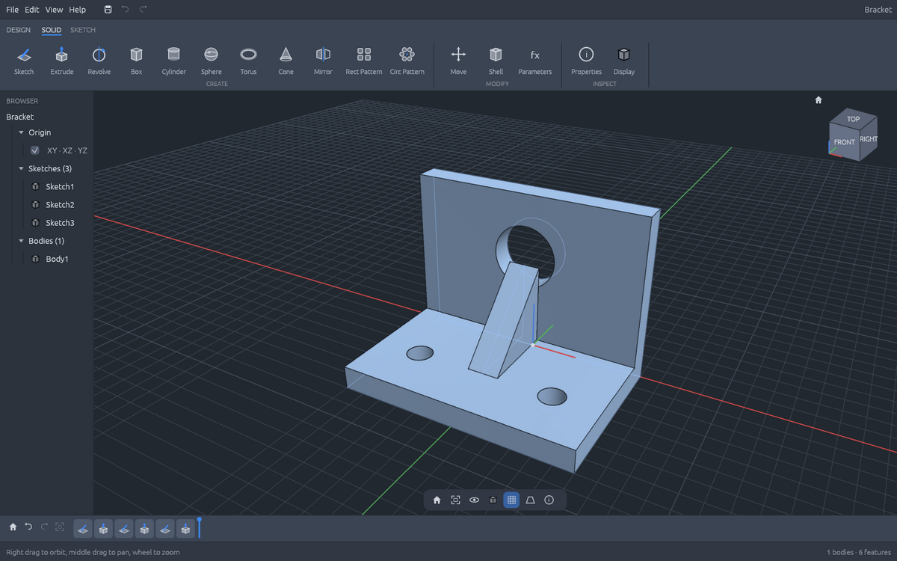

# FusionCraft

A parametric 3D CAD app in Rust, in the spirit of Autodesk Fusion, built the same way as the other Craft apps: a layered Cargo workspace, an egui interface, and every action available as a command.



FusionCraft is a clean-room project. Nothing in it comes from Autodesk software: the layout follows the publicly visible Fusion workflow, and all icons are drawn in code.

## Features

- **Sketches** on the XY, XZ and YZ origin planes or on any flat face of a body: line, 2-point rectangle, center circle, polygon, 3-point arc and point, with grid and point snapping, construction geometry and typed sizes (`30x20`, `25` then Enter).
- **Profiles** are found automatically, including holes and nested regions, and can be picked in the viewport.
- **Features**: Extrude (one side or symmetric), Revolve, Box, Cylinder, Sphere, Torus, Cone, Mirror, rectangular and circular patterns, Move and Shell, each as New Body, Join, Cut or Intersect.
- **Timeline** with a history marker: roll back, edit any feature (double-click), suppress, rename or delete it. A feature that fails turns red and keeps its error message; the rest of the design still evaluates.
- **Parameters**: every size is an expression such as `width / 2 + 5 mm`, with units mm, cm, m, in, ft, deg and rad.
- **Viewport**: shaded, shaded with edges or wireframe, ViewCube, Home and Fit, orthographic or perspective, body visibility and selection.
- **Files**: `.fcraft` designs (JSON), export to binary STL, ASCII STL and OBJ.
- **Undo and redo** for every change.

## Build and run

```sh
cargo run --release -p fusioncraft              # desktop app
cargo run --release -p fusioncraft -- part.fcraft
```

On Linux the app needs the usual X11 or Wayland libraries (`libxkbcommon-x11`, Mesa).

## Controls

| Action | Input |
|---|---|
| Orbit | Right drag, or Shift + middle drag |
| Pan | Middle drag |
| Zoom | Mouse wheel (zooms at the cursor) |
| Sketch tools | L line, R rectangle, C circle, P polygon, A arc, X construction |
| Finish sketch and extrude | E |
| Undo / redo | Ctrl+Z / Ctrl+Y |
| Save / open / new | Ctrl+S / Ctrl+O / Ctrl+N |
| Export STL | Ctrl+E |
| Home view / fit | Home / F6 |

## Command line

`fusioncraft-cli` runs the same commands as the app, which makes designs scriptable and testable without a window.

```sh
fusioncraft-cli run examples/bracket.json --save bracket.fcraft --export bracket.stl --png bracket.png
fusioncraft-cli exec feature.box '{"width": 40, "depth": 20, "height": "10 mm"}' --save part.fcraft
fusioncraft-cli info part.fcraft
fusioncraft-cli render part.fcraft out.png --view top
fusioncraft-cli commands
```

A script is a JSON list of steps such as `{"cmd": "feature.extrude", "distance": "thick"}`; see `examples/bracket.json`.

## Layout

| Crate | Layer | Purpose |
|---|---|---|
| `fusioncraft-geom` | L0 | Vectors, planes, polygons and triangulation, meshes, BSP booleans, extrude and revolve, primitives |
| `fusioncraft-doc` | L1 | The design document: parameters and expressions, sketches, profiles, timeline features |
| `fusioncraft-model` | L2 | Evaluates the timeline into bodies, with per-feature errors |
| `fusioncraft-render` | L2 | Software rasterizer with edges, picking and PNG output (no GPU needed) |
| `fusioncraft-io` | L3 | Open and save `.fcraft`, STL and OBJ export |
| `fusioncraft-engine` | L4 | Command registry, undo and redo |
| `fusioncraft-ui-egui` | L5 | The desktop interface |
| `apps/fusioncraft`, `apps/fusioncraft-cli` | apps | Binaries |

Lower layers never depend on higher ones, and only the UI crate uses egui. Production code has no `unwrap`, `expect` or `panic`, and `unsafe` is forbidden; commands treat every input as hostile and return errors instead.

## Not yet

Fillet and chamfer, sketch constraints and dimensions, holes and threads, STEP import and export, and a GPU renderer.

## License

MIT OR Apache-2.0, like the rest of this repository.
